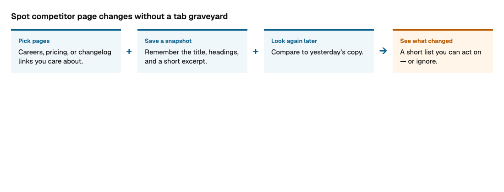
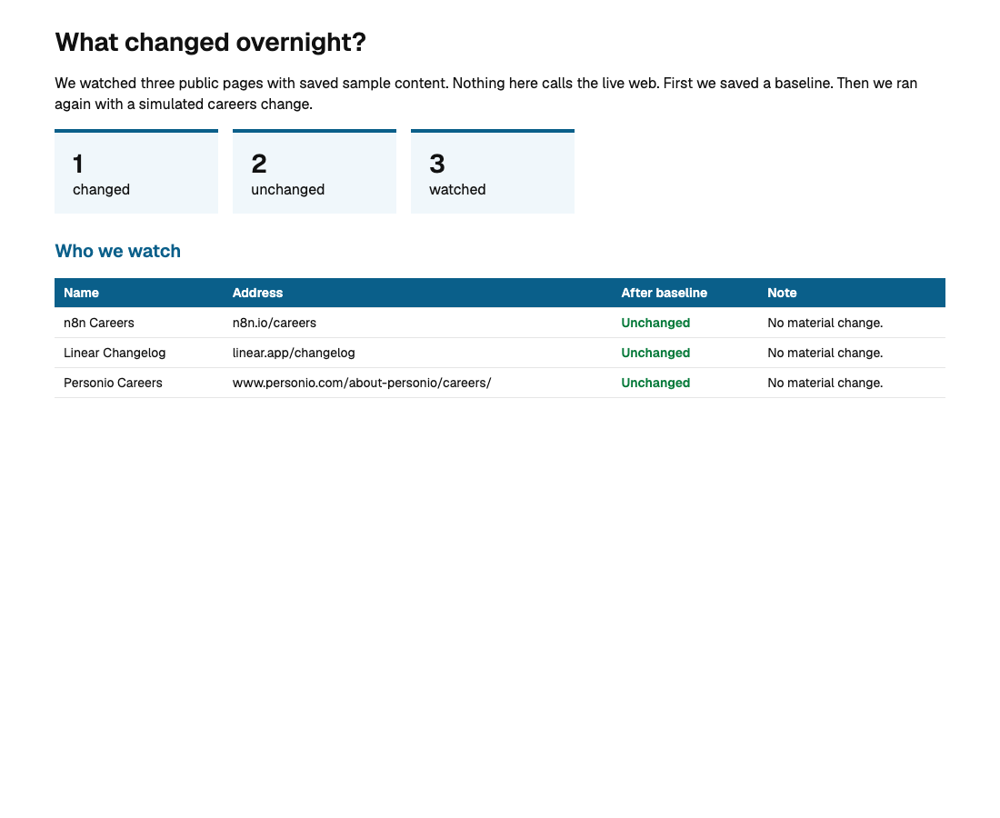
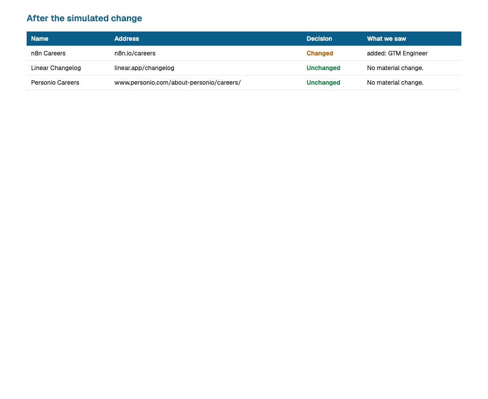

# Watch Desk

This is a small desk that watches competitor pages and tells you what changed.

You pick careers, pricing, or changelog links. The desk saves a snapshot, looks again later, and writes a short report. A saved sample stands in for the live web, so you can try it with no account.



## Why this exists

Opening the same three tabs every Monday does not scale. The desk remembers what the page looked like, names the difference in plain language, and stays quiet when nothing moved.

That is the value: attention only where something actually changed.

## What the words mean

| Word | What it means |
| --- | --- |
| **Target** | One page you care about (careers, pricing, changelog). |
| **Snapshot** | The last title, headings, and short excerpt we saved. |
| **Changed** | Something material moved since the last look. |
| **Unchanged** | No material change — leave it alone. |
| **Simulated change** | Offline demo that pretends a careers page added a role. |

The full field list is in `VARIABLE_SCHEMA.md`.

## The lab (fake test)

```bash
python3 -m venv .venv
source .venv/bin/activate
pip install -r requirements.txt
python experiments.py
```

It seeds a baseline, checks again (unchanged), then runs a simulated careers change.





The same pictures, with a short note, are in [docs/watchdesk-lab.pdf](docs/watchdesk-lab.pdf).

To rebuild screenshots and the PDF:

```bash
pip install playwright
playwright install chromium
python scripts/make_lab_pdf.py
```

## Day-to-day offline

```bash
python watch.py --reset --seed
python watch.py
python watch.py --simulate
```

## Live crawl (optional)

Edit `targets.yml`, put `FIRECRAWL_API_KEY` in `.env`, then:

```bash
python watch.py --reset --seed --live
python watch.py --live
```

Default sample targets (also used live): n8n Careers, Linear Changelog, Personio Careers.
